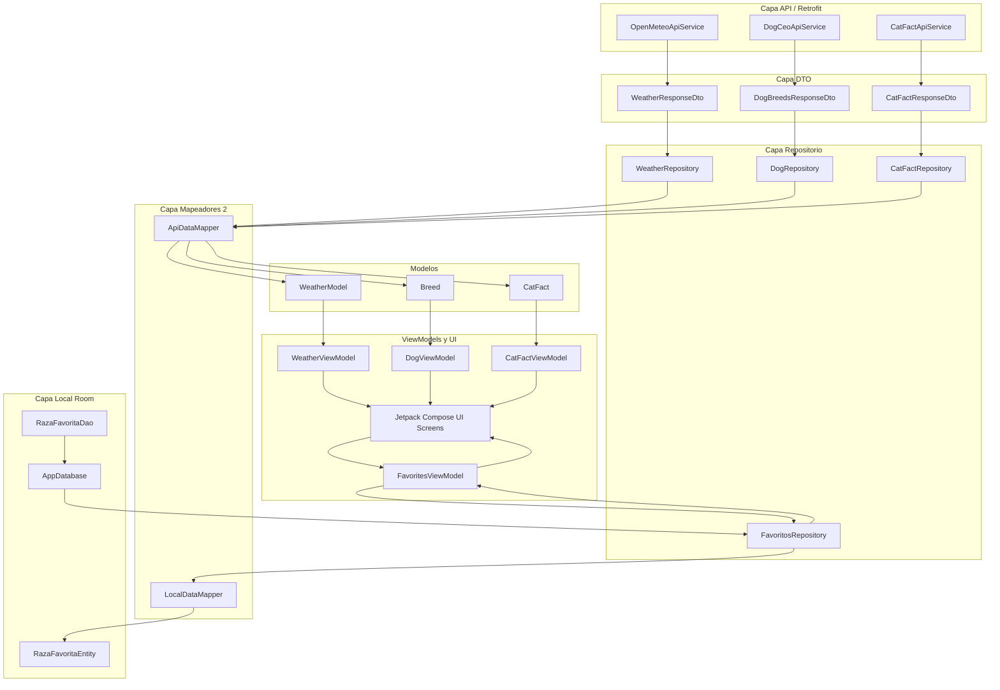

# Diseño de Clases y Base de Datos — Grupo 2: "Explorador de naturaleza y clima"

## 1. Arquitectura MVVM y Capas (`API → Repository → Mapper → DB`)

La aplicación implementa una separación estricta de responsabilidades entre capas, consolidando los modelos en la carpeta `model` y los mapeadores en **exactamente 2 componentes**:

- **API (`data/remote/api` y `data/remote/dto`)**: Tres servicios Retrofit independientes (`OpenMeteoApiService`, `DogCeoApiService`, `CatFactApiService`) con sus respectivos DTOs.
- **Repository (`data/repository`)**: Un repositorio por cada API (`WeatherRepository`, `DogRepository`, `CatFactRepository`) y un repositorio para persistencia local (`FavoritosRepository`), que gestionan las peticiones, errores y acceso a datos sin contener lógica de UI.
- **Mapper (`data/mapper`)**: Dos mappers consolidados:
  1. `ApiDataMapper`: Responsable de transformar todos los DTOs de las tres APIs remotas (`WeatherResponseDto`, `DogBreedsResponseDto`, `CatFactResponseDto`) en sus respectivos modelos (`WeatherModel`, `Breed`, `CatFact`) ubicados en `model/`.
  2. `LocalDataMapper`: Responsable de la conversión bidireccional entre el modelo `Breed` (`model/`) y la entidad de base de datos Room `RazaFavoritaEntity`.
- **DB (`data/local`)**: Capa de Room con la entidad `RazaFavoritaEntity` (tabla `razas_favoritas`), el DAO `RazaFavoritaDao` (`Flow` y `suspend`), y la base de datos Singleton `AppDatabase`.
- **Presentation (`ui/` y `model/`)**: Modelos puros en `model/` y ViewModels con `UiState` y `StateFlow` que alimentan las pantallas de Jetpack Compose.

---

## 2. Diseño de la Base de Datos (Room)

Tabla: `razas_favoritas`

| Columna | Tipo | Restricción | Descripción |
| :--- | :--- | :--- | :--- |
| **nombre** | TEXT | PRIMARY KEY, NOT NULL | Nombre único de la raza de perro |
| **cantidadSubrazas** | INTEGER | NOT NULL | Cantidad de subrazas registradas |

- **Propósito**: Almacenar localmente las razas marcadas como favoritas para persistir entre sesiones de la aplicación sin requerir conexión a internet.
- **DAO (`RazaFavoritaDao`)**: Proporciona operaciones asíncronas con `suspend` para inserción y borrado (`@Query("DELETE FROM razas_favoritas WHERE nombre = :nombre")`), y flujos observables con `Flow<List<RazaFavoritaEntity>>` para lectura reactiva.
